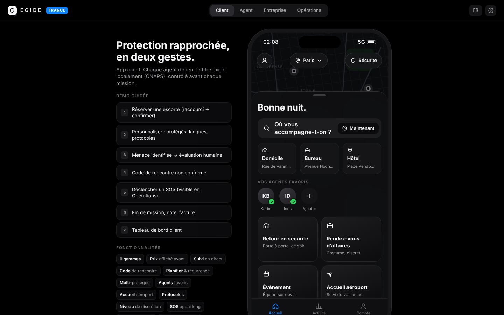
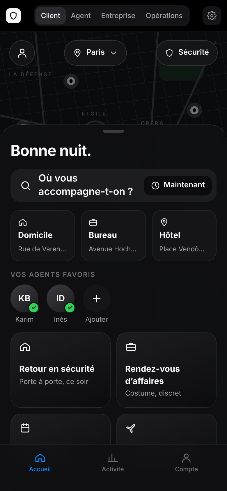

# ÉGIDE — la protection rapprochée à la demande

[](https://github.com/Skysaks/EGIDE/actions/workflows/ci.yml)

> **EN** — An on-demand close-protection platform, shown end to end: the client app (book in two taps, upfront price, live tracking, meeting code, long-press SOS), the officer app, the business portal (duty of care, approvals, policy, invoices) and the operations console (live missions, vetting, compliance). Two editions: France and Global (eight cities, five currencies).

**Démonstrations** : [édition France](https://skysaks.github.io/EGIDE/) · [édition Global](https://skysaks.github.io/EGIDE/global.html) · fichiers autonomes : [`dist/egide-france.html`](dist/egide-france.html), [`dist/egide-global.html`](dist/egide-global.html) (à télécharger et ouvrir, hors ligne).



> © 2026 Florian Iglesias — Tous droits réservés. Dépôt public à titre de portfolio uniquement : aucune licence n'est concédée. Voir [LICENSE](LICENSE).

## Le principe

Réserver un agent de protection reste une affaire de relations, de devis par téléphone et de confiance aveugle. ÉGIDE l'aborde comme un service à la demande, avec ce que la sécurité exige en plus : agent titulaire d'un titre professionnel vérifié, prix affiché avant de confirmer, **code de rencontre** pour ne suivre personne sans vérification, **mot de détresse**, SOS par appui long relayé à la console d'opérations, confirmation d'arrivée.

La démonstration montre les quatre faces du produit, connectées entre elles : un SOS déclenché côté client apparaît en direct dans la console.

## Fonctionnalités

**Application client** — six gammes (Escorte, Privé, Détail, Mobilité, Événement sur devis, Renforcée sur dossier), contextes (déplacement professionnel, soirée, personnalité exposée…), multi-protégés, agents favoris, langues, niveau de discrétion, protocoles, accueil aéroport, planification et récurrence, suivi en direct, note, pourboire et facture.

**Application agent** — passage en ligne, briefing de mission, mission en cours, planning, revenus, documents.

**Portail entreprise** — vue d'ensemble et budget, voyageurs et *duty of care*, approbations au-delà d'un seuil, politique de protection, factures et exports, contrat-cadre.

**Console d'opérations** — missions en direct sur la carte, alertes, vérification des agents (titre professionnel, assurance, formation continue avec blocage à J-90, dossier complet), majorations de nuit et de forte demande par ville.

**Démonstrations guidées** — réserver, personnaliser, menace identifiée avec évaluation humaine, code de rencontre non conforme, SOS, fin de mission, tableau de bord.

| Ordinateur (édition France) | Téléphone |
|---|---|
|  |  |

## Deux éditions, un seul code

| | France | Global |
|---|---|---|
| Langue par défaut | français | anglais |
| Villes | Paris, Lyon, Côte d'Azur, Toulouse | Londres, Paris, Genève, Madrid, Berlin, Dubaï, New York, Los Angeles |
| Devises | EUR | GBP, EUR, CHF, AED, USD |
| Numéros d'urgence | par ville | par ville |

Les deux pages partagent toutes leurs feuilles de style et tous leurs modules ; seul le fichier d'édition (`src/js/editions/france.js` ou `global.js`) change : marché, ville par défaut, villes avec coefficient de prix, coordonnées, quartiers, lieux, agents fictifs et numéros d'urgence.

## Construire et tester

Node 22 (voir `.nvmrc`). Aucune dépendance d'exécution ; Playwright sert uniquement aux tests.

```bash
npm ci
npm run dev        # http://localhost:5173 (France) et /global.html, reconstruits à chaque modification de src/
npm run build      # src/ → dist/egide-france.html et dist/egide-global.html
npm run verify     # aucune ressource externe, budget de taille, aucune donnée personnelle
npm test           # tests d'intégrité (node:test) + parcours bureau et mobile des deux éditions (Playwright)
npm run captures   # régénère docs/captures/
```

## Structure du dépôt

```
src/
  france.html, global.html    gabarits des deux éditions (langue, titre, fichier d'édition)
  styles/                     01-base … 06-reglages, communs aux deux éditions
  js/
    editions/france.js        configuration de l'édition France
    editions/global.js        configuration de l'édition Global
    02-noyau.js … 07-…        noyau, villes, gammes et prix, état, graphiques SVG, données de démonstration
    08-app-client.js          application client
    09-app-agent.js           application agent
    10-portail-entreprise.js  portail entreprise
    11-console-operations.js  console d'opérations
    12-reglages-routeur.js    réglages, routeur des vues, démonstrations guidées, démarrage
dist/egide-france.html, dist/egide-global.html   fichiers construits, autonomes (≈ 205 Ko chacun)
scripts/  tests/  docs/
```

## Choix techniques

- **Une configuration par édition** plutôt qu'un fichier par marché : ajouter une ville, c'est ajouter un objet de données.
- **Prix calculé et détaillé** : tarif horaire de la gamme × coefficient de la ville × durée, protégés supplémentaires, majoration de nuit et de forte demande, frais de service et TVA, affichés avant confirmation.
- **Carte et graphiques dessinés en SVG**, sans bibliothèque ni tuiles externes : la démonstration tourne hors ligne.

## Limites connues

1. **Démonstration** : agents, missions, entreprises et paiements simulés ; aucune réservation réelle.
2. **Carte schématique** : quartiers et trajets stylisés, pas de cartographie réelle.
3. **Réglementation** : la vérification des titres et assurances est représentée, pas branchée sur des registres officiels.
4. **Tests automatiques sur Chromium** (bureau et mobile émulé) ; Safari et Firefox ne sont pas couverts par la CI.

## Sécurité et confidentialité

Aucune donnée réelle : agents, clients et entreprises fictifs. Les préférences (langue, thème) restent dans le navigateur. Signalement des failles : [SECURITY.md](SECURITY.md).

## Licence

© 2026 Florian Iglesias — Tous droits réservés ([LICENSE](LICENSE)). Contributions : [CONTRIBUTING.md](CONTRIBUTING.md).
