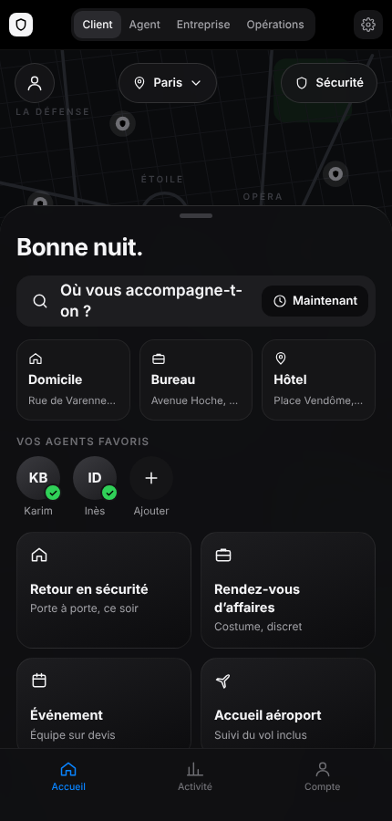

# EGIDE

Protection rapprochée à la demande : réserver un agent de sécurité qualifié comme on réserve une course, avec le cadre légal de chaque pays intégré au produit.

## Fonctionnalités

- Parcours client : besoin, lieu, horaire, niveau de protection, suivi de mission
- Espaces Agent, Entreprise et Opérations
- Règles d'exercice, autorisations et mentions légales propres à chaque pays
- Deux éditions : `france.html` (marché français) et `global.html` (international, bilingue)

## Lancer

Ouvrir `france.html` ou `global.html` dans un navigateur.

## Fonctions connectées

Les exports de documents s'activent lorsque la page est publiée comme artefact sur claude.ai, qui fournit le téléchargement de fichiers générés. Ouverte directement dans un navigateur, l'application bascule en mode local : l'application reste entièrement utilisable, données enregistrées dans le navigateur.

## Technique

Deux applications monofichiers en JavaScript sans dépendance, conçues mobile d'abord.

## Statut

Prototype de démonstration. Les données (agents, missions, entreprises) sont fictives.

## Droits

© 2026 Florian Iglesias – Tous droits réservés. Code publié à titre de présentation : aucune licence d'utilisation, de copie ou de redistribution n'est accordée.
